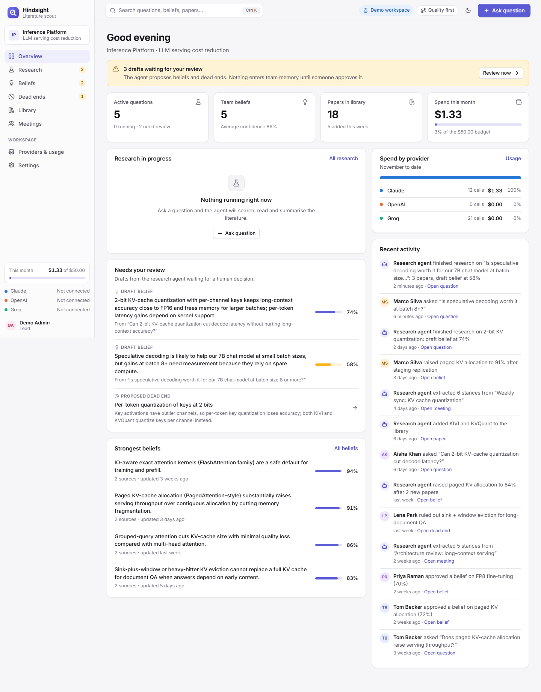
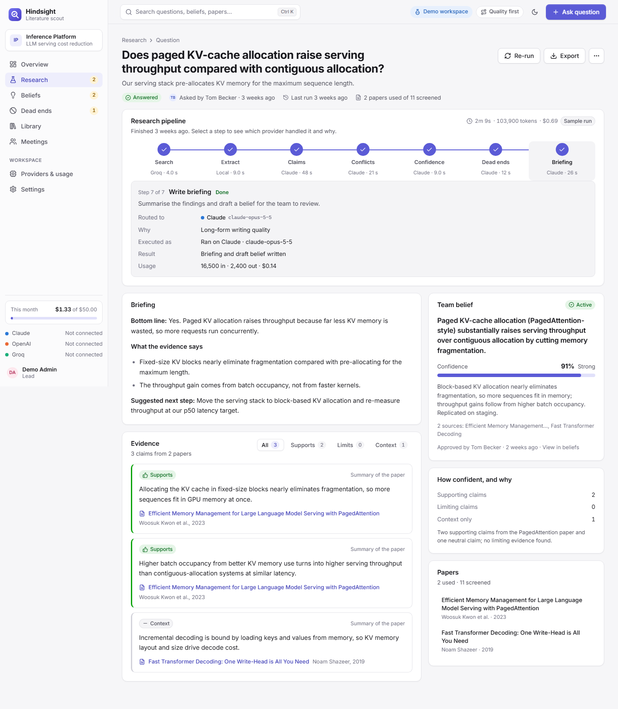
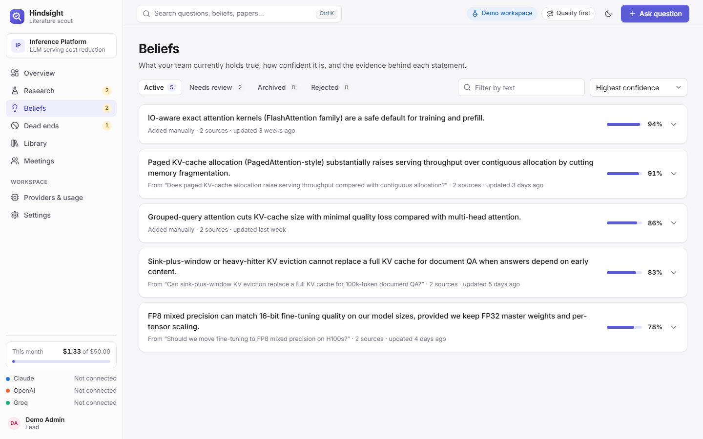
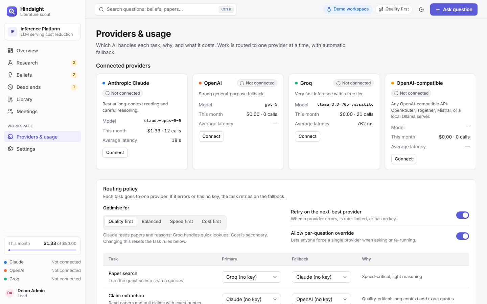

# resAIDserch

**An autonomous literature scout and shared memory for engineering teams.**

Ask a technical question. resAIDserch searches arXiv, reads the papers, extracts claims, flags where sources disagree, and proposes beliefs and dead ends for your team to approve. What the team decides is remembered, so the same ground is never re-researched.

**Live demo:** https://resaidserch.vercel.app



## Features

- **Research pipeline:** search, claim extraction, contradiction detection, confidence scoring, dead-end proposals, and a written briefing per question.
- **Human in the loop:** agent findings land in a review queue; nothing becomes a team belief until someone approves it.
- **Team memory:** beliefs, dead ends, papers and meetings are kept in one workspace and searchable (`Ctrl/Cmd+K`).
- **Meeting stances:** paste a transcript and see each person's position on the topics discussed.
- **Multi-provider routing:** route each task type to Claude, OpenAI or Groq, with a usage and cost log.
- **Dark mode and mobile layouts.**

| Question and findings | Beliefs | Providers |
|---|---|---|
|  |  |  |

## Architecture

```
React + Vite (Vercel)  ──HTTPS──▶  FastAPI (Google Cloud Run)  ──▶  AlloyDB / Postgres (optional)
                                          │
                                          └──▶ arXiv API, Claude / OpenAI / Groq
```

- **Frontend:** React 18, TypeScript, Vite, TanStack Query, Zustand, React Router. Lives in [frontend/](frontend/).
- **Backend:** FastAPI app in [backend/demo_server.py](backend/demo_server.py). Paper search uses the real arXiv API. LLM steps run through the configured providers, and fall back to demo mode when no API keys are set.
- **Persistence:** in memory by default. Set `HINDSIGHT_DATABASE_URL` (Postgres or AlloyDB) and the workspace is snapshotted to the database after every change and reloaded on start. Run a single instance, because state is held in-process.
- **CI/CD:** a Cloud Build trigger runs [backend/cloudbuild.yaml](backend/cloudbuild.yaml) on every push to `master` and deploys to Cloud Run.

More detail: [docs/ARCHITECTURE.md](docs/ARCHITECTURE.md).

## Run locally

Requirements: Python 3.11+, Node.js 20+.

```bash
# Backend (http://localhost:8000, API docs at /docs)
cd backend
python -m venv venv
source venv/bin/activate        # Windows: venv\Scripts\activate
pip install -r requirements.txt
cp .env.example .env            # optional: add ANTHROPIC_API_KEY / OPENAI_API_KEY / GROQ_API_KEY
uvicorn demo_server:app --port 8000 --reload

# Frontend (http://localhost:5173), in a second terminal
cd frontend
npm install
npm run dev
```

The Vite dev server proxies `/api` to the backend. To use a different backend port, change `API_TARGET` in [frontend/vite.config.ts](frontend/vite.config.ts).

Or with Docker, which also starts Postgres:

```bash
docker compose up
```

## Deploy

| Part | Where | How |
|---|---|---|
| Backend | Google Cloud Run | Cloud Build trigger on `master`, see [docs/DEPLOYMENT.md](docs/DEPLOYMENT.md) |
| Frontend | Vercel | Project root directory `frontend`; set `VITE_API_URL` to `<backend-url>/api` |
| Database (optional) | AlloyDB | [infrastructure/alloydb-setup.sh](infrastructure/alloydb-setup.sh) |

## API

The backend serves interactive docs at `/docs`. Main route groups under `/api`: `questions`, `beliefs`, `dead-ends`, `papers`, `meetings`, `providers`, `routing`, `usage`, `tasks`, `search`, `settings`, `members`.

## Project layout

```
backend/          FastAPI server, Dockerfile, Cloud Build config
frontend/         React + Vite app
infrastructure/   AlloyDB / VPC setup script
docs/             Architecture, deployment and quickstart guides
pics/             Screenshots
```

## License

[MIT](LICENSE)
