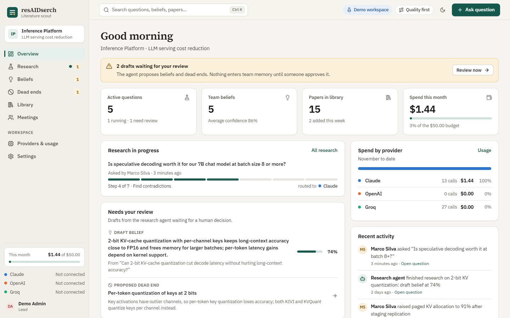
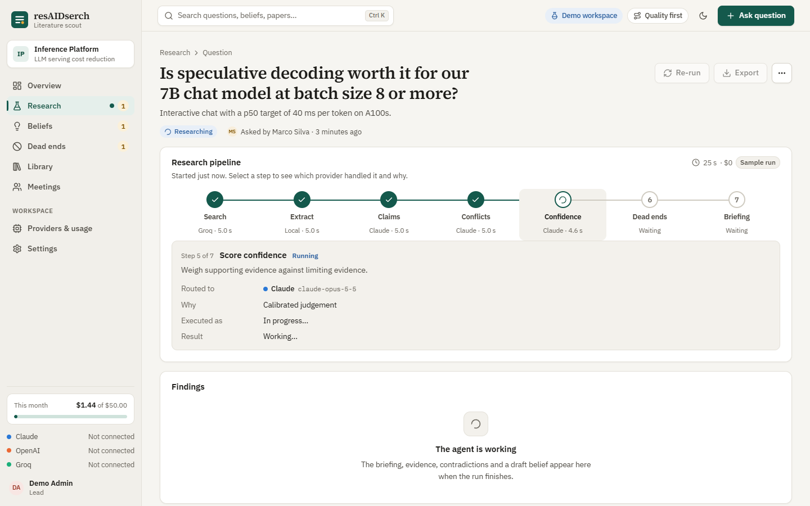
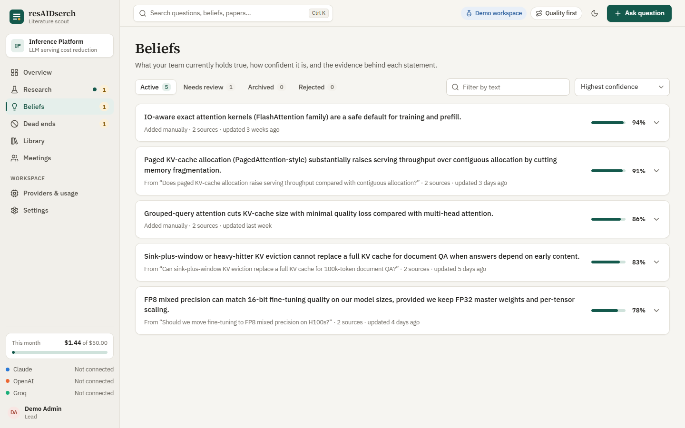
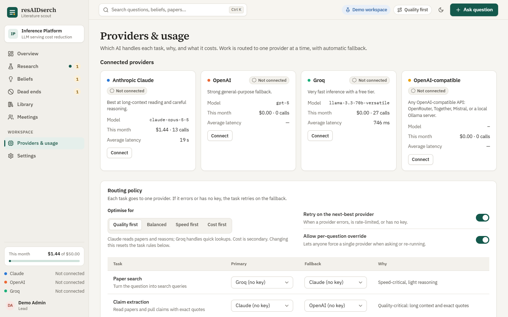
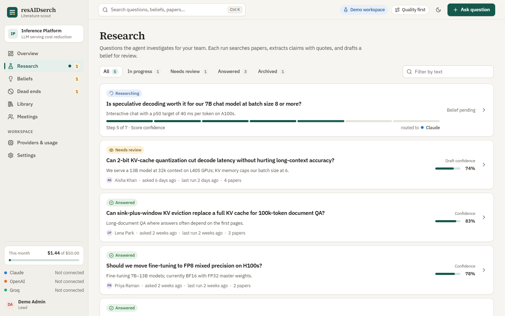
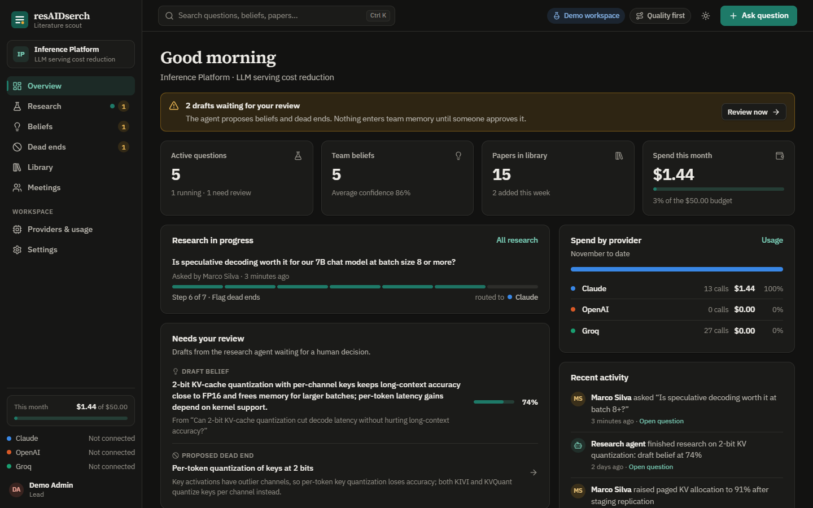
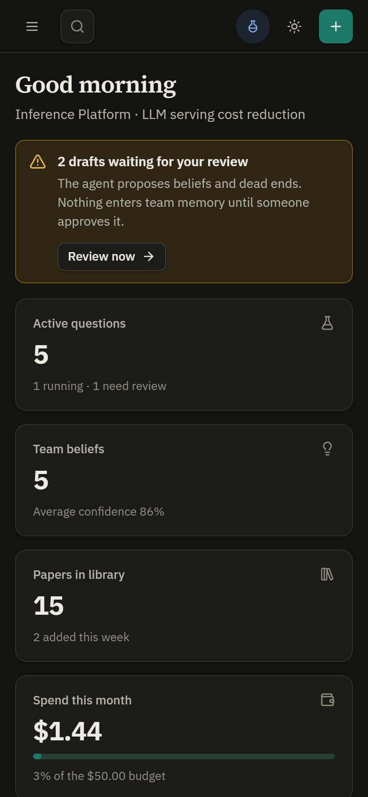

# resAIDserch

**An autonomous literature scout and shared memory for engineering teams.**

Ask a technical question. resAIDserch searches arXiv, reads the papers, extracts claims, flags where sources disagree, and proposes beliefs and dead ends for your team to approve. What the team decides is remembered, so the same ground is never re-researched.

**Live demo:** https://resaidserch.vercel.app (sample data, shared by all visitors)



## Features

- **Research pipeline:** search, claim extraction, contradiction detection, confidence scoring, dead-end proposals, and a written briefing per question.
- **Human in the loop:** agent findings land in a review queue; nothing becomes a team belief until someone approves it.
- **Team memory:** beliefs, dead ends, papers and meetings live in one searchable workspace (`Ctrl/Cmd+K`).
- **Meeting stances:** paste a transcript and see each person's position on the topics discussed.
- **Multi-provider routing:** route each task type to Claude, OpenAI or Groq, with fallback and a usage and cost log.
- **Light, dark and mobile layouts.**

| Research run | Beliefs | Providers |
|---|---|---|
|  |  |  |

| Research queue | Dark mode | Mobile |
|---|---|---|
|  |  |  |

## Architecture

```
React + Vite (Vercel)  ──HTTPS──▶  FastAPI (Google Cloud Run)  ──▶  Postgres / AlloyDB (optional)
                                          │
                                          └──▶ arXiv API, Claude / OpenAI / Groq
```

- **Frontend** ([frontend/](frontend/)): React 18, TypeScript, Vite, TanStack Query, React Router.
- **Backend** ([backend/demo_server.py](backend/demo_server.py)): a single FastAPI app. Paper search uses the real arXiv API. LLM steps call the configured providers and fall back to labelled heuristics when no API keys are set.
- **Persistence:** in memory by default. Set `HINDSIGHT_DATABASE_URL` and the workspace is snapshotted to Postgres or AlloyDB after every change and reloaded on start. Run a single instance, because state is held in-process.

## Run locally

Requirements: Python 3.11+, Node.js 20+.

```bash
# Backend: http://localhost:8001 (API docs at /docs)
cd backend
python -m venv venv
source venv/bin/activate        # Windows: venv\Scripts\activate
pip install -r requirements.txt
cp .env.example .env            # optional: add provider API keys
python demo_server.py

# Frontend: http://localhost:5173 (in a second terminal)
cd frontend
npm install
npm run dev
```

The Vite dev server proxies `/api` to the backend on port 8001 (`API_TARGET` in [frontend/vite.config.ts](frontend/vite.config.ts)).

Or run everything, including Postgres, with Docker:

```bash
docker compose up
```

## Deploy

| Part | Where | How |
|---|---|---|
| Backend | Google Cloud Run | `gcloud builds submit --config backend/cloudbuild.yaml` (or a Cloud Build trigger on `master`) |
| Frontend | Vercel | Root directory `frontend`, env `VITE_API_URL=<backend-url>/api` |
| Database (optional) | AlloyDB | [infrastructure/alloydb-setup.sh](infrastructure/alloydb-setup.sh) |

The backend scales to zero when idle. [.github/workflows/keep-warm.yml](.github/workflows/keep-warm.yml) pings it every 5 minutes to avoid cold starts.

## License

[MIT](LICENSE)
